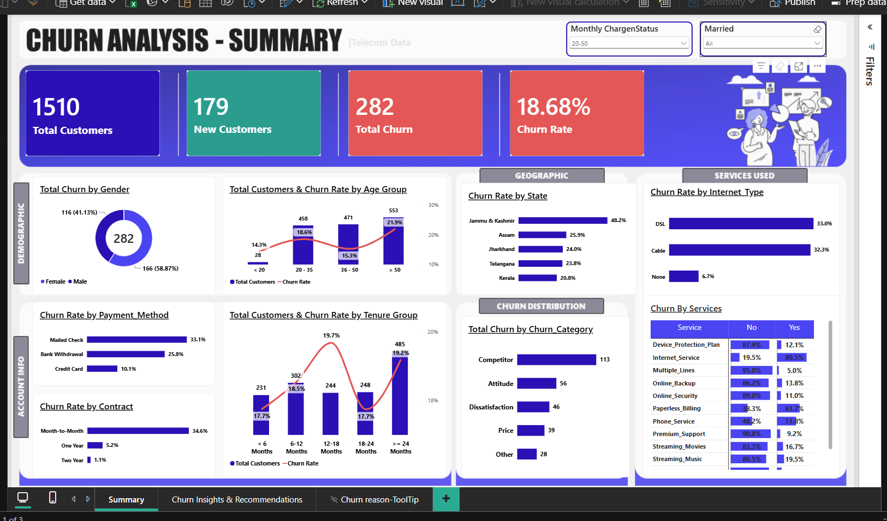
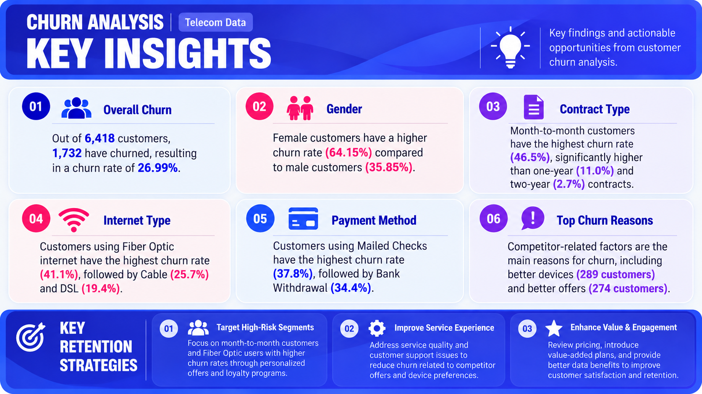

# Telecom Customer Churn Analysis | SQL & Power BI

## 📌 Project Overview

This project analyzes telecom customer churn using SQL and Power BI to identify churn patterns, understand customer behavior, and provide actionable recommendations to improve customer retention.

## 🎯 Business Questions

- What is the overall customer churn rate?
- Which customer segments have higher churn rates?
- How do contract type, internet service, payment method, tenure, age group, and location relate to churn?
- What are the major reasons customers leave?
- What retention strategies could help reduce customer churn?

## 🛠️ Tools & Technologies

- **SQL Server:** Data exploration, data quality checks, data cleaning, aggregations, and percentage analysis.
- **Power BI:** Interactive dashboards, KPI cards, data visualization, and business insights.
- **DAX:** Churn-related KPI calculations.

## 🔍 SQL Analysis

- Explored the customer dataset and reviewed its structure.
- Checked NULL values across relevant columns.
- Used `ISNULL()` to handle missing categorical values in a separate cleaned table.
- Analyzed customer distributions by gender, contract type, and state.
- Used `COUNT()`, `GROUP BY`, subqueries, and percentage calculations.

## 📊 Key Findings

- **Overall Churn:** 1,732 out of 6,418 customers churned, resulting in a churn rate of **26.99%**.
- **Contract Type:** Month-to-month customers recorded the highest churn rate at **46.5%**, compared with 11.0% for one-year contracts and 2.7% for two-year contracts.
- **Internet Type:** Fiber Optic customers had a churn rate of **41.1%**.
- **Payment Method:** Customers using mailed checks recorded a churn rate of **37.8%**.
- **Age Group:** Customers aged over 50 had the highest churn rate among the displayed age groups at **31.6%**.
- **Geographic Location:** Jammu & Kashmir had the highest displayed state churn rate at **57.2%**.
- **Churn Reasons:** Competitor-related factors were prominent, including better devices (289 customers) and better offers (274 customers).

## 💡 Retention Recommendations

1. **Target High-Risk Segments:** Develop targeted retention campaigns for customer segments with higher churn.
2. **Improve Customer Experience:** Investigate service quality, customer support, and competitor-related concerns.
3. **Strengthen Customer Value:** Review pricing, contract options, and value-added benefits to encourage long-term retention.

## 🖥️ Dashboard Preview

### Summary Dashboard



### KeyInsights with Retention Strategies



## 🎥 LinkedIn Project Walkthrough

Watch the video walkthrough of my Telecom Customer Churn Analysis project on LinkedIn.

**[View Project Walkthrough on LinkedIn](https://lnkd.in/p/d5iBTGYX)**

## 📁 Repository Structure

```text
Telecom-Customer-Churn-Analysis/
│
├── README.md
│
├── SQL/
│   ├── CustChurn.SQL
│   ├── CustChurnEDA.sql
│   └── .gitkeep
│
└── PowerBI/
    ├── ChurnAnalysis.pbix
    ├── Churn_Analysis.pdf
    ├── KeyInsights with Retention Strategies.png
    ├── Summary.png
    └── .gitkeep
```

## 🚀 Project Outcome

This project demonstrates practical SQL analysis, data cleaning, Power BI dashboard development, churn KPI analysis, and business-focused recommendations to support customer retention decisions.

**Skills:** SQL | Power BI | DAX | Data Cleaning | Exploratory Data Analysis | Data Visualization | Business Intelligence | Customer Churn Analysis

